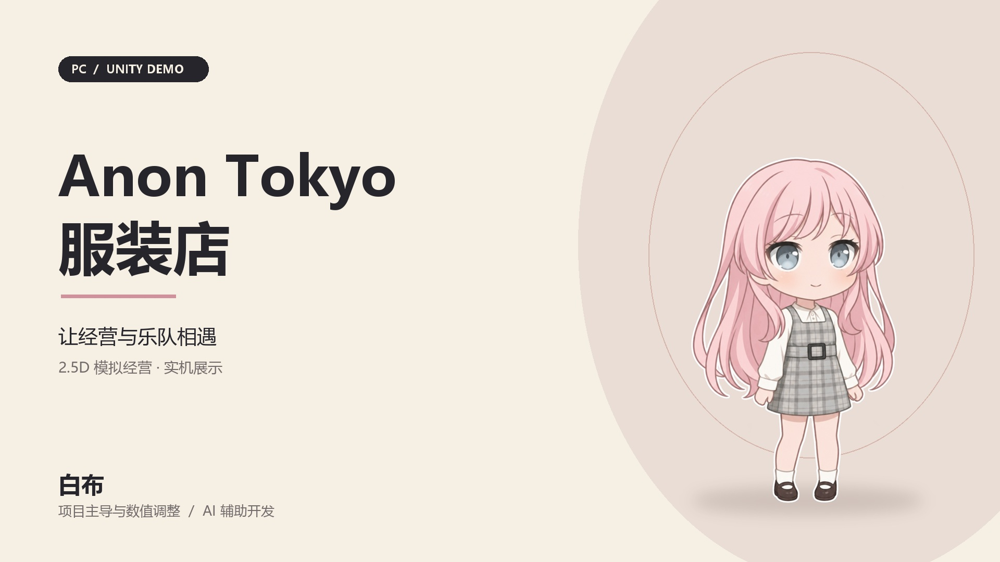

# Anon Tokyo 服装店

**白布主导的 Unity PC 单机模拟经营 Demo，采用 2D 纸片角色与 3D 店铺场景。**

白布负责项目方向、玩法设计、数值调整与迭代验收；开发与部分美术制作采用 AI 辅助流程。项目为 BanG Dream! 非官方同人学习与作品集原型。



## 下载与展示

- [Windows Demo 1.0 与作品集视频](https://github.com/b1031125037-ops/Anon-Tokyo/releases/tag/v1.0-demo)
- [84 秒实机展示视频](https://github.com/b1031125037-ops/Anon-Tokyo/releases/download/v1.0-demo/Anon-Tokyo-Portfolio.mp4)
- [游戏设定与迭代记录](游戏设定总案.md)

下载 Release 中的 Windows ZIP，完整解压后运行最外层的 `Anon tokyo 1.0 demo.exe`。请保留同目录的 `_Data`、`UnityPlayer.dll` 等运行文件。

## 已实现内容

- 采购、陈列、顾客挑选、排队付款与库存结算的完整经营流程。
- 收银、补货、招待岗位与角色属性；双补货员工按分工取货并补架。
- 道路行人、概率进店与自主购物，购买种类和数量受经营状态影响。
- 七类商品、实物陈列、展柜升级、逐格地板及逐列墙纸装修。
- 店铺五级成长、最高 12×12 空间、角色签约与 FEVER 五人舞台演出。
- 爱音对话引导、任务、三格普通存档、独立无限资源模式和经营失败处理。
- 左键拖动平移、中键拖动旋转、滚轮缩放、方向键移镜与 Esc 设置。

这是持续迭代中的可玩原型，数值和表现仍会调整。设定文档保留开发历史，后续修订覆盖早期规则。

## 打开工程

1. 安装 **Unity 6000.3.26f1**，并添加 Windows Build Support。
2. 在 Unity Hub 中添加 `prototype/PaperShop` 文件夹。
3. 首次打开时等待 Package Manager 下载依赖和 Unity 导入资源。
4. 打开 `Assets/Scenes/ShopFoundation.unity`，点击 Play。

使用 **C# / URP 17.3.0**。仓库包含工程资源与 `.meta` 文件，不包含 Library、旧构建、玩家存档或原始制作过程资料。

## 构建 Windows 版

编辑器菜单：`Anon Tokyo → Build Windows Foundation`。

也可以在项目根目录运行 PowerShell：

```powershell
./prototype/Build-Foundation.ps1 -OutputFolder ShopWindows `
  -UnityEditorPath "C:\Program Files\Unity\Hub\Editor\6000.3.26f1\Editor\Unity.exe"
```

可以用 `UNITY_EDITOR_PATH` 环境变量指定编辑器；省略参数时脚本也会检查常见安装路径。输出位于 `prototype/ShopWindows/AnonTokyo.exe`。构建会执行项目中的规则检查，并写入本地 `prototype/foundation-build.log`。

`art/characters/performance_v001/delivery/png` 中的 20 张角色交付图用于构建时校验已导入的表演与庆祝动作，因此需要与工程目录一起保留。

## 素材与归属

本项目与 BanG Dream! 官方无关联。角色名称、设定及原作音乐等素材的权利归各自权利人；3D 模型由白布提供，部分代码与美术使用 AI 辅助完成。公开此仓库用于展示开发过程，不代表授予第三方角色、音乐或其他素材的再分发与商用权利，也不对全部内容作统一的 MIT / CC 授权。
